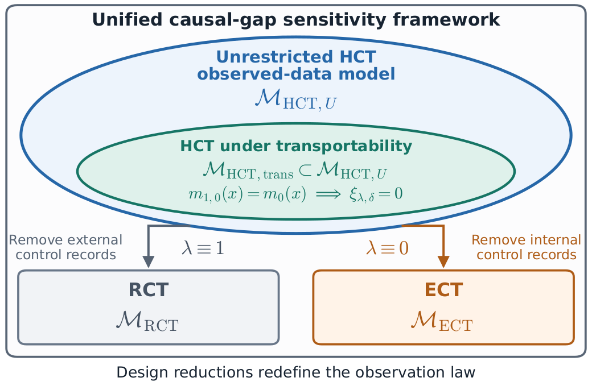

# causalgap: external controls in clinical trials

[](https://yain22.github.io/Unified_Semiparametric_HCT/r-package.html)

If a trial replaces some of its concurrent controls with external patients, how much precision does it gain, and what effect does it estimate? This repository accompanies Se Yoon Lee's *A Unified Semiparametric Framework for Prospective Causal-Gap Sensitivity Analysis Across Randomized, Externally Controlled, and Hybrid Trials*.

[**R package and manual**](https://yain22.github.io/Unified_Semiparametric_HCT/r-package.html) · [**Explore the EIF and its three reductions**](https://yain22.github.io/Unified_Semiparametric_HCT/eif-models.html) · [**Replication guide**](https://yain22.github.io/Unified_Semiparametric_HCT/)

## Reproduce a result in R

[Download the replication files](https://yain22.github.io/Unified_Semiparametric_HCT/replication-source.zip), extract them, and open `HCT.Rproj`. Run these lines in the **R console** at the project root:

```r
source("analysis/reproduce.R")
reproduce("tables")
planning <- read.csv("results/tables/table-3a.csv")
subset(planning, scenario == "I" & method == "HCT Gaussian reference")$power
# Approximately 0.832
```

This recreates 15 CSVs using base R and bundled inputs. Table 3 is calculated from enrollment counts, variances and the planned treatment effect. Tables based on simulations or clinical analyses use the saved summaries. No clinical records or simulation refits are needed for this command.

| To reproduce | In the same R session | Where to look |
|:--|:--|:--|
| Tables 2–4 and S4–S12 | `reproduce("tables")` | `results/tables/` |
| Figures 1–11 and S1–S9 | `reproduce("figures")` | `results/figures/` |
| A short estimator check on synthetic data | `reproduce("validate")` | `results/validate/` |

Figures require R with Cairo graphics and the `jsonlite` package (`install.packages("jsonlite")`). The estimator check and simulation refits also need `data.table` and `digest`.

[Find an individual figure or table](analysis/paper-map.csv). Table 1 displays the EIF; Tables S1–S3 define notation and data structures. Table 4 and Tables S10–S12 describe the CGM analysis.

## Use the estimator

Download the [R source package](https://yain22.github.io/Unified_Semiparametric_HCT/downloads/causalgap_0.1.0.tar.gz), then select that file in R:

```r
install.packages(file.choose(), repos = NULL, type = "source")
library(causalgap)
precision_share(p = 0.5, e = 2/3, v_internal = 1, v_external = 1)
# [1] 0.25
```

Here one quarter of the hybrid control mean comes from internal controls. If their mean exceeds the external mean by 0.20 at each covariate value, the borrowing contrast exceeds the trial effect by 0.15. Use `aipw_u()` with fitted nuisance predictions to estimate both contrasts and their difference. The [package manual](docs/downloads/causalgap-reference.pdf) describes the inputs.

## Explore the theory

[](https://yain22.github.io/Unified_Semiparametric_HCT/eif-models.html)

- [**Compare the four influence functions.**](https://yain22.github.io/Unified_Semiparametric_HCT/eif-models.html) Select a model, read its formula, and evaluate it for a treated patient or a control. In an externally controlled single-arm trial, the borrowing target is identified under overlap, but its gap from the trial effect is not identified without an additional assumption.
- [**Check a pathwise derivative.**](https://yain22.github.io/Unified_Semiparametric_HCT/eif-lab.html) Perturb a conditional outcome law and compare the resulting target change with its EIF prediction.
- [**Plan a trial.**](https://yain22.github.io/Unified_Semiparametric_HCT/design-lab.html) Change the number of internal controls or the discrepancy between sources to compare power and false positives.

## Refit the analyses

Simulation fitting uses three R packages: `install.packages(c("data.table", "digest", "jsonlite"))`. Run `reproduce("smoke")` for four repetitions to check your installation. A successful smoke run exits without error and writes four `run-completed.txt` files under `results/smoke/`. For the manuscript's 5,000 repetitions at each specified sample size and scenario, run `reproduce("refit", workers = 4)`. The latter fits the baseline, paired oracle, extended scenarios and quadratic comparator, builds calibration and one-sided summaries, and writes tables and figures from the new runs. It can take substantial time. [Simulation settings and seeds](analysis/simulations/README.md) · [Numerical checks](REPRODUCIBILITY.md).

The published CGM summaries are sufficient for the clinical table and forest plot. To refit the estimators or repeat the participant bootstrap, obtain the trial and registry archives separately under the distributor's terms. [Clinical data and R instructions](analysis/clinical/README.md).
